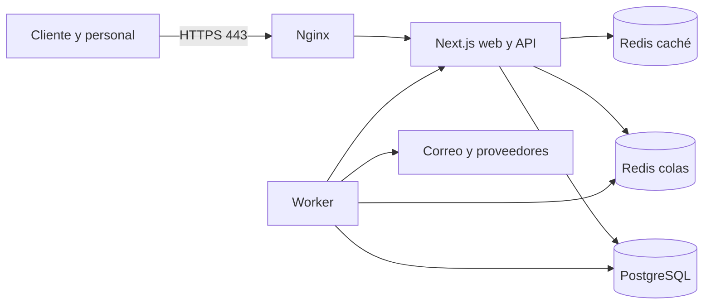

# Arquitectura propuesta

Estado: arquitectura confirmada e implementación inicial. Fecha: 19 de noviembre de 2026. El alcance verificado y las tareas productivas pendientes se registran en [DESARROLLO.md](DESARROLLO.md).

## Stack y responsabilidades

Monolito modular en TypeScript, con proceso web y worker independiente compartiendo módulos de negocio. Una base de reglas y tareas lentas separadas de la atención de pedidos.

| Capa | Selección | Motivo y límite |
|---|---|---|
| Web y servidor | React + Next.js App Router + TypeScript | Páginas públicas renderizadas y paneles interactivos; dominio fuera de componentes |
| Runtime/paquetes | Node.js 24 + npm workspaces | Lockfile compartido y versiones verificadas al construir |
| UI | Tailwind CSS + shadcn/ui | Componentes personalizables y patrones accesibles; comprobar resultado con teclado y lectores |
| Iconos/toasts | Lucide React y toast de shadcn/ui | Coherencia visual; toast complementa bandeja persistente |
| Formularios | React Hook Form + Zod | Formularios y contratos validados también en servidor |
| Datos en cliente | TanStack Query | Consultas, invalidación y reconsulta en paneles; evitar duplicar estado servido por Next.js |
| Estado local | Context/reducer inicialmente | Carrito/preferencias; Zustand solo ante necesidad concreta |
| Tablas/reportes | TanStack Table y Recharts al construir esos módulos | Paginación de servidor y gráficos con alternativa tabular |
| Identidad | Sesiones opacas de servidor y bcrypt | Tokens hasheados, cookie HttpOnly, revocación y recuperación por correo |
| Persistencia | PostgreSQL + Prisma ORM | Integridad, transacciones y esquema versionado |
| Caché | Redis | Catálogo/configuración pública con TTL; sin autoridad sobre precios/pagos |
| Tareas | BullMQ + worker Node.js | Reintentos de correo, notificaciones y escalamiento; eventos durables en PostgreSQL |
| Tiempo real | SSE + comandos HTTP | Servidor → navegador, con reconexión y recuperación |
| Entrada pública | Nginx + TLS | Proxy inverso, límites y acceso único |
| Entornos | Docker Compose y CI/CD | Desarrollo, staging y producción aislados |
| Calidad | ESLint, formateador, Vitest y Playwright | Tipos, dominio, integración y flujos completos |

Selección orientada al restaurante, evitando librerías duplicadas. Fijar versiones estables y compatibles en lockfile al implementar; este documento no ordena instalar automáticamente la última versión.

Referencias: [Next.js](https://nextjs.org/docs/app/guides/self-hosting), [shadcn/ui](https://ui.shadcn.com/docs), [Tailwind](https://tailwindcss.com/), [TanStack Query](https://tanstack.com/query/latest/docs/framework/react/overview), [React Hook Form](https://react-hook-form.com/), [Zod](https://zod.dev/), [Lucide](https://lucide.dev/), [Better Auth](https://better-auth.com/docs/introduction), [BullMQ](https://docs.bullmq.io/), [Vitest](https://vitest.dev/) y [Playwright](https://playwright.dev/).

## Next.js, API REST y PostgreSQL

**Decisión confirmada:** frontend React con Next.js App Router y backend TypeScript en Route Handlers REST bajo `/api/v1`. Módulos de dominio independientes de la interfaz, contratos Zod compartidos y Prisma como único propietario del esquema. Sesiones opacas en servidor; permisos y validación en cada operación. No se usará una conexión a base desde el navegador.

**PostgreSQL es la base; PostgREST queda fuera de la primera versión.** [PostgREST genera una API desde PostgreSQL](https://docs.postgrest.org/en/stable/). Añadirlo exigiría definir roles/políticas de base y su límite con las operaciones transaccionales; no sustituye por sí solo los servicios de negocio.

## Red prevista



Nginx será el único servicio publicado en producción: 443 y, si corresponde, 80 para redirección/validación TLS. Next.js, PostgreSQL y Redis en red privada sin `ports` hacia Internet. Administración de base por túnel/VPN o acceso local restringido.

«Ocultar puertos» significa evitar su publicación y filtrar red, no solo quitar números de URLs. Complementar proxy con firewall, credenciales y mínimo privilegio. Next.js recomienda proxy inverso al autohospedar; para SSE deshabilitar buffering en ruta de eventos y ajustar timeouts/heartbeats. [Guía oficial](https://nextjs.org/docs/app/guides/self-hosting).

Worker → web representa señal interna autenticada o distribución mediante Redis; eventos reconstruibles desde PostgreSQL. Con varias instancias, distribuir señales sin depender de memoria local.

## Módulos

Identidad/permisos; catálogo; salón; pedidos/comandas; caja; fidelización; atención al consumidor (libro, sugerencias y valoraciones separados); notificaciones; administración/reportes/auditoría.

Los handlers autentican, validan y llaman al dominio; los servicios controlan permisos por recurso y transacciones. Prisma solo en servidor; el navegador no accede a PostgreSQL/Redis.

## Carpetas

```text
apps/
  web/src/
    app/                  Páginas Next.js y API REST /api/v1
    lib/                  HTTP, entorno, cliente y controles compartidos
    modules/
      administracion/     Panel y gestión
      identidad/          Sesiones, registro y recuperación
      catalogo/           Carta, carrito y caché
      mesas/              Atención y QR
      pedidos/            Estados, autorización e idempotencia
      cocina/             Evolución de estaciones y comandas parciales
      caja/               Pagos y tickets
      inventario/         Evolución de recetas y movimientos
      notificaciones/     Bandeja y outbox
      reclamaciones/      Hojas, constancias y sugerencias
  worker/src/             BullMQ, correo y recordatorios
packages/
  database/               Cliente Prisma, esquema, SQL y semilla local
  contracts/              Contratos Zod, estados y utilidades monetarias
  ui/                     Componentes personalizables compartidos
infra/nginx/              Proxy inverso
scripts/                  Preparación del entorno local
tests/                    Reglas y pruebas de integración/navegador
docs/                     Arquitectura, API y operación
```

Las carpetas de evolución no suponen módulos terminados. En esta entrega el despacho REST central delega operaciones en servicios; al crecer cada área se separarán sus handlers manteniendo `/api/v1` estable.

## Redis y operación

Separar caché y colas en instancias Redis distintas en producción: caché con expulsión; colas con `noeviction`, persistencia y memoria monitorizada. Bases lógicas distintas no separan políticas de memoria. En desarrollo podrán compartir instancia con configuración compatible con colas.

TTL inicial propuesto: carta pública 60 segundos y configuración pública 300, invalidando tras cambios y con claves por local/versión. Checkout consulta precios/disponibilidad en PostgreSQL. No cachear respuestas personales públicamente ni usar caché para autorizar. Si falla Redis, carta consulta base con límites y eventos permanecen en outbox. Sin commit en PostgreSQL no hay confirmación de pedido.

Logs estructurados con ID de solicitud/pedido/evento, sin secretos o contenido personal de reclamos. Métricas: latencia, errores, conexiones, demora de outbox/colas, correo fallido y comandas sin atender. Endpoints separados de vida/preparación y estado degradado explícito.

Respaldos cifrados, copia externa y restauraciones verificadas. Objetivos propuestos: RPO 15 minutos y RTO 2 horas, condicionados a archivo WAL/recuperación puntual e infraestructura ensayada; un dump diario no cumple ese RPO. Definir retención y responsables antes de publicar.

## Seguridad y despliegue

Cookies de sesión `HttpOnly`, `Secure`, `SameSite`, expiración/revocación y protección CSRF/origen para mutaciones. Rol y propiedad en cada operación; límites de login/formularios, validación de cargas y escape de contenido. Secretos fuera de Git y variables públicas. Usuario de ejecución con menos permisos que migraciones. Auditar cambios de roles, precios, pagos, estados y respuestas al libro.

Pipeline: instalación desde lockfile → tipos/lint → pruebas → build → staging → respaldo/migración controlada → despliegue → salud y flujo principal. Migraciones una vez por release con credenciales propias; [sintaxis según versión de Prisma elegida](DATOS.md).
